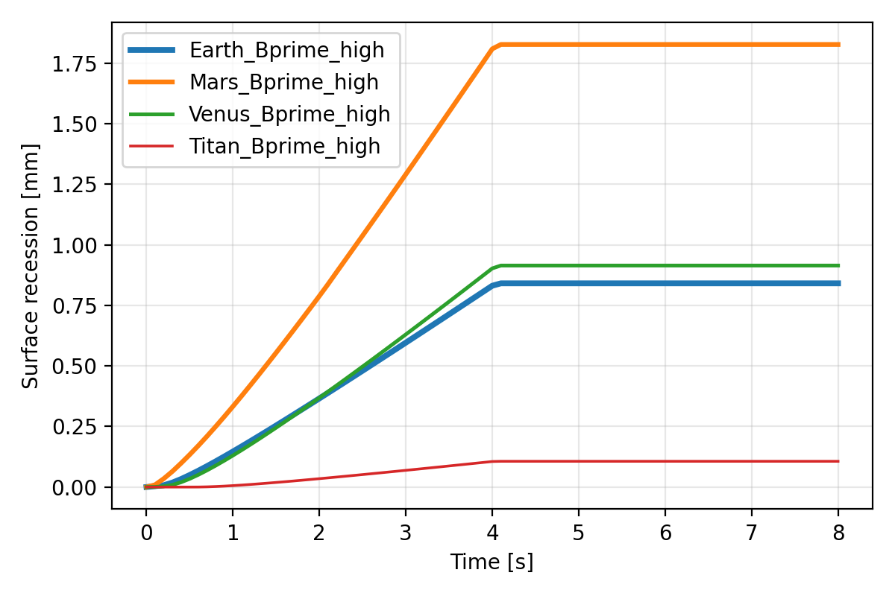

# FEChAR

**F**inite **E**lement-based **Ch**arring and **A**blation **R**esponse model (1D)

A [FreeFEM](https://freefem.org/) solver for the thermal response, pyrolysis-gas transport and surface recession of charring ablative heat-shield materials. It ships with the **TACOT** reference material and with surface-chemistry (B') tables for four planetary atmospheres: **Earth, Mars, Venus and Titan**.

Governing equations and numerical method: [`docs/THEORY.md`](docs/THEORY.md).



*Example output of the ramp tutorial: surface recession in four atmospheres (quick-test settings, see the tutorial).*

## What it solves

Given a heating history at the front face, FEChAR marches in time and predicts, through the material thickness:

- temperature
- density (degree of decomposition from virgin material to char)
- pyrolysis-gas pressure
- surface recession

It couples in-depth conduction, pyrolysis kinetics and Darcy gas flow with a surface energy balance. The surface chemistry (char ablation rate `B'c` and wall enthalpy `hw`) is read from pre-tabulated B' tables.

## Quick start

**1. Install FreeFEM** 4.x **with the `msh3` plugin** (the official installers from [freefem.org](https://freefem.org/) include it). The code calls `rm -rf` and `mkdir` through `system()`, so use Linux, macOS or WSL.

> **Ubuntu / Debian note.** The `freefem++` package alone has no plugins, and `load "msh3"` fails. On Ubuntu 24.04 (FreeFEM 4.13) install the plugin package too and point FreeFEM to it:
> ```bash
> sudo apt install freefem++ libfreefem++
> export FF_LOADPATH=/usr/lib/freefem++
> ```

**2. Run a tutorial.** Each tutorial is a self-contained folder; **run FreeFEM from inside it**, because all data paths are relative (`../../Datafolder/...`).

```bash
git clone https://github.com/<your-username>/FEChAR.git
cd FEChAR/Tutorials/ConvectiveRamp_Bprime
FreeFem++ -nw main.edp -tend 2 -ele 100          # short test, about 30 s
```

`-nw` runs without a graphics window. Progress (the current time) prints to the terminal and results go to a folder named after the case, for example `case_Earth_Bprime_high/`.

**Warning:** every run deletes and recreates its case folder. Copy results elsewhere if you want to keep them.

**3. Look at the results** (still inside the tutorial folder).

```bash
python ../../scripts/plot_results.py case_Earth_Bprime_high
```

A step-by-step guide to the ramp problem in any environment is in
[`Tutorials/ConvectiveRamp_Bprime/Tutorial_ConvectiveRamp_Bprime.pdf`](Tutorials/ConvectiveRamp_Bprime/Tutorial_ConvectiveRamp_Bprime.pdf).

### Run time

The default is 120 s of physical time with 500 elements and `dt = 0.005 s`. On the machine used for testing (one core) this costs roughly 70 s of wall-clock time per simulated second, i.e. about 2.5 hours for a full run. For quick tests use `-ele 100` (about 13 s per simulated second, wall temperature within roughly 1 to 3 % of the 500-element result) and a short `-tend`.

**Keep `dt` at 0.005 s or smaller.** With the 0.1 s heating ramp-up, `dt = 0.01 s` made the iteration diverge in tests (on both 100 and 200 elements). The Dirichlet tutorial likewise diverged with 100 elements and `dt = 0.02 s`.

## Tutorials

| Folder | `bcType` | Boundary condition at the front face |
|---|---|---|
| [`Tutorials/DirichletBC`](Tutorials/DirichletBC) | 0 | Prescribed wall-temperature history (ramp to 1644 K) |
| [`Tutorials/ConvectiveQcase`](Tutorials/ConvectiveQcase) | 2 | Prescribed net wall heat flux (ramp to 500 kW/m²), no B' tables, no recession |
| [`Tutorials/ConvectiveRamp_Bprime`](Tutorials/ConvectiveRamp_Bprime) | 1 | Aerothermal edge condition with B' tables, surface recession; **Earth / Mars / Venus / Titan** |

The three folders contain the same solver files. They differ only in `params.idp` (`bcType` and `useAblation`).

## Configuration

Everything you normally change is in [`params.idp`](Tutorials/ConvectiveRamp_Bprime/params.idp) of the tutorial folder you run.

| Setting | Values | Meaning |
|---|---|---|
| `bcType` | `0` / `1` / `2` | Boundary condition: wall temperature / aerothermal with B' tables / net heat flux |
| `Environment` | `"Earth"`, `"Mars"`, `"Venus"`, `"Titan"` | B' table and wall pressure, see below |
| `heatbc` | `"low"`, `"intermediate"`, `"high"` | Heating level = plateau of the recovery enthalpy (`bcType = 1`) |
| `useRadiation` | `true` / `false` | Surface re-radiation (`bcType` 1 or 2) |
| `useAblation` | `true` / `false` | `bcType = 1` only. **`true`: B' tables are used** (blowing correction, wall enthalpy, char ablation, recession). **`false`: tables are not used**, the wall flux is `ρeueCH·Hr` minus re-radiation, there is no recession, and `Environment` only sets the wall pressure |
| `tRampUp`, `tRampOff`, `tRampDown` | seconds | Heating ramp: up-time, time at which the ramp-down starts, down-time |
| `reuechPeak`, `qconvPeak`, `TwPeak` | numbers | Plateau of `ρeueCH` [kg/m²/s], of the net heat flux [W/m²], of the wall temperature [K] |
| `L`, `tend`, `dt`, `ele` | numbers | Thickness [m], end time [s], time step [s], number of elements |
| `ploton` | `true` / `false` | Plot the solution on screen every time step (slows the run; needs a graphics window) |

### Command-line overrides

The most-used settings can be changed without editing any file:

```bash
FreeFem++ -nw main.edp -env Mars -heat low -tend 10 -ele 100 -dt 0.005 -toff 4
```

| Flag | Overrides | Flag | Overrides |
|---|---|---|---|
| `-env` | `Environment` | `-tup` | `tRampUp` |
| `-heat` | `heatbc` | `-toff` | `tRampOff` |
| `-tend` | `tend` | `-tdown` | `tRampDown` |
| `-ele` | `ele` | `-dt` | `dt` |

The output folder name is built from the settings: `case_<Environment>_Bprime_<heatbc>` for `bcType = 1`, `case_<Environment>_Qconv` for `bcType = 2`, and `case_<Environment>_Dirichlet` for `bcType = 0`.

### Environments and wall pressure

The wall pressure is constant during a run and is set per environment in `params.idp` (variable `prwall`):

| `Environment` | Wall pressure [Pa] |
|---|---|
| Earth | 101 325 |
| Mars | 610 |
| Venus | 9.2 × 10⁶ |
| Titan | 146 900 |

### The heating ramp

Every boundary-condition history is a trapezoidal pulse, defined once by the macro `pulse(t)` in [`Datafolder/bc/Boundary1.idp`](Datafolder/bc/Boundary1.idp): linear ramp-up over `tRampUp`, plateau until `tRampOff`, linear ramp-down over `tRampDown`, then zero. Defaults: 0.1 s, 60 s, 0.1 s. For `bcType = 1`, `ρeueCH` rises to 0.3 kg/m²/s and the recovery enthalpy to a plateau chosen by `heatbc`:

| `heatbc` | Recovery enthalpy plateau |
|---|---|
| `low` | 1.5 MJ/kg |
| `intermediate` | 13.3 MJ/kg |
| `high` | 25 MJ/kg |

To use another heating level, add one `else if` branch in `params.idp` (section 2). For a completely different shape, replace the macros in `Boundary1.idp` by any function of time in SI units.

## Limitations

- **B' table pressure range.** All four tables cover only **101.3 Pa to 101 325 Pa (0.001 to 1 atm)**. A wall pressure outside that range is clamped to the nearest table pressure and a warning is printed at start-up. Earth and Mars are inside the range. **Venus (9.2 MPa) and Titan (146.9 kPa) are above it**, so those runs use the 1 atm table data. Read their results with that in mind until tables for the correct pressures are generated.
- A one-time warning is also printed the first time the wall temperature leaves 250 to 4000 K or `B'g` leaves 0 to 10 (values are clamped). A brief `B'g` excursion at the end of a ramp-down is harmless: `B'g` is the pyrolysis-gas flux divided by `ρeueCH`, which goes to zero there.
- 1D through-thickness only, Darcy gas transport, equilibrium surface chemistry, and no mechanical response (stress, cracking, spallation). See [`docs/THEORY.md`](docs/THEORY.md).

## Output

All files are tab-separated text and can be read by any plotting tool. They are in `<casename>/`.

| File | Columns |
|---|---|
| `out_<t>.dat` | Profiles through the thickness at time `t` (one file every 0.1 s): `x` [m], `T` [K], pressure [Pa], density [kg/m³]. `x` is measured from the original front surface |
| `boundarydat.dat` | `t`, pressure at the front node [Pa], wall temperature `Tw` [K], `B'g`, `B'c`, wall enthalpy `hw` [J/kg] |
| `BC.dat` | `t`, recession rate `ṡ` [m/s], front-face position [m] |
| `mgeq.dat` | `t`, pyrolysis-gas mass flux at the wall, char mass flux at the wall [kg/m²/s] |
| `WEnergyBalance.dat` | `t`, then the surface energy-balance terms in W/m²: `ρeueCH·Hr`, `ρeueCH·hw`, `ρeueCH·B'·hw`, `ρeueCH·B'c·hc`, `ρeueCH·B'g·hg`, re-radiation, conduction into the solid |
| `inflocv.dat`, `inflocc.dat` | `t`, density threshold, position of the virgin front (98 % virgin) and the char front (2 % char remaining) |
| `info.dat` | Run header (settings) and the final thickness |

Terms that do not exist for a given `bcType` are written as zero (for example `B'c` and `hw` for `bcType = 0` or `2`). The surface energy balance is
`q_cond = ρeueCH·[Hr − (1 + B')·hw + B'c·hc + B'g·hg] − ε·σ·(Tw⁴ − T∞⁴)`, with `B' = B'c + B'g`.

### Post-processing scripts

Python 3 with NumPy (and Matplotlib for the figures). Each takes the case folder as argument:

```bash
python scripts/postprocess.py case_Earth_Bprime_high
```

## Repository layout

```
Tutorials/
  README.md                      how the tutorials are organised
  DirichletBC/                   bcType = 0
  ConvectiveQcase/               bcType = 2
  ConvectiveRamp_Bprime/         bcType = 1, with the PDF tutorial and a reference run
    main.edp                     entry point: time loop and output
    params.idp                   ALL user settings, constants, data loading, B' lookup
    meshsetup.idp                1D mesh
    fespace_init_varf.idp        finite-element space, fields, initial conditions, variational forms
    run_all_environments.sh      runs Earth, Mars, Venus and Titan in turn
    reference_results/           outputs of a quick run, to check an installation
Datafolder/
  Macro_operator.idp             generic FreeFEM helper macros (not essential)
  bc/Boundary1.idp               heating-ramp histories (pulse macro)
  tacotdata/
    macro2.idp                   TACOT material model: kinetics, properties
    materialprop.dat             solid (virgin / char) property tables
    pyrogas_prop.txt             pyrolysis-gas property table
    Bprimetables/                B' tables: Earth, Mars, Venus, Titan
scripts/                         Python post-processing
docs/THEORY.md                   governing equations and numerics
legacy/                          earlier drafts and unused code, not used by the solver
```

`main.edp` includes the files in a fixed order (`params.idp`, material macros, boundary conditions, operator macros, mesh, field setup), because each depends on the one before it.

## B' table format

Each file `Bprime_table_modified_<Environment>.dat` has five columns:

```
P [Pa]   Tw [K]   B'g   B'c   hw [J/kg]
```

The grid is regular: 4 pressures (101.325, 1013.25, 10132.5, 101325 Pa) × 101 values of `B'g` (0 to 10, step 0.1) × 151 wall temperatures (250 to 4000 K, step 25 K) = 61 004 rows, with pressure as the outermost index and temperature the innermost.

At each step the solver computes `B'g` from the pyrolysis-gas flux and the edge coefficient, then `lookupBprime(P, Tw, B'g)` (in `params.idp`) interpolates `B'c` and `hw` **trilinearly in (log₁₀ P, B'g, Tw)**. The result is iterated with the blowing correction on `ρeueCH` until it is consistent. To add another atmosphere, provide a table in the same layout, add one `else if` line with its wall pressure to `params.idp` (section 7), and, if the grid differs, update `NPb`, `NBg`, `NTw` and `nBprime`.

## Using a different material

The solver only calls macro names such as `cpv`, `kv`, `hv`, `cpc`, `kc`, `hc` and `denvarA/B/C`. To change the material, replace `Datafolder/tacotdata/macro2.idp` and its `.dat` / `.txt` tables. `main.edp` stays the same.

## Troubleshooting

| Message | Cause and fix |
|---|---|
| `Load error : msh3` | FreeFEM without the `msh3` plugin, see the installation note above |
| `Error opening file ../../Datafolder/...` | FreeFEM was started outside the tutorial folder. `cd` into `Tutorials/<case>/` first |
| `Compile error ... macro2.idp` or odd errors in a macro | File saved with Windows (CRLF) line endings. Convert to LF (`.gitattributes` prevents this in Git) |
| `Sorry error in Optimization ... nan` | The iteration diverged: use `dt <= 0.005` (tested with 100 to 500 elements) |
| `WARNING: wall pressure ... outside the B' table range` | Expected for Venus and Titan, see Limitations |

## Validating changes

There is no automated test suite. Run the reference case before and after a change and compare with
[`reference_results/`](Tutorials/ConvectiveRamp_Bprime/reference_results) (the command is in its README):
`Tw` in `boundarydat.dat` and the recession history in `BC.dat` should be unchanged within numerical noise.

## License

MIT, see [`LICENSE`](LICENSE).
